 

  <samp>INDEPENDENT DEVELOPER</samp>
  &nbsp;·&nbsp;
  <samp>DESKTOP SOFTWARE</samp>
  &nbsp;·&nbsp;
  <samp>CREATING IN THE DARK</samp>

<a href="https://youtube.com/@qypxr">YOUTUBE</a>
&nbsp; ◇ &nbsp;
<a href="https://t.me/qypxr1">TELEGRAM</a>
&nbsp; ◇ &nbsp;
<a href="https://steamcommunity.com/id/qypxr/">STEAM</a>

 

---

### SOMEWHERE BETWEEN CODE AND THE COSMOS

*Quiet interfaces. Strange ideas. Things built from nothing.*

 

## TRANSMISSIONS

<table>
<tr>
<td width="50%" valign="top">

### ◉ QYPXR METHOD

A C++ desktop tool for MP4 container workflows, wrapped in a custom **Event Horizon** interface.

<a href="https://github.com/qypxr/QYPXR_METHOD">OPEN PROJECT ↗</a>

</td>
<td width="50%" valign="top">

### ◈ SMART GRABBER

A desktop media utility built around video and audio downloads, with `yt-dlp` and FFmpeg.

<a href="https://github.com/qypxr/Smart-Grabber">OPEN PROJECT ↗</a>

</td>
</tr>
</table>

 

## THE TOOLKIT

  
  
  
  
  

 

NO NOISE. JUST SIGNAL.

  

<code>Q Y P X R</code> &nbsp; / &nbsp; LOST IN THE EVENT HORIZON

